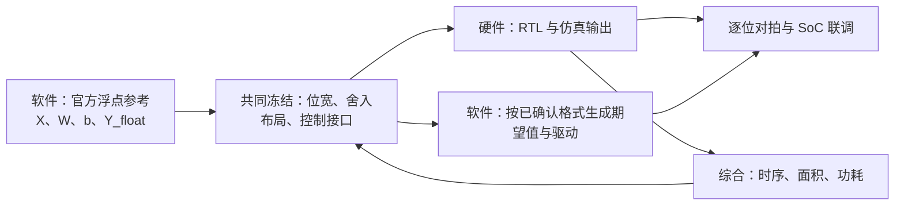

# 从一段语音到一块加速器：KWT-1 芯片设计赛题零基础教材

> 面向第一次接触芯片设计、机器学习和数值量化的本科生。版本：2026-10-17。本文聚焦**本科组**和你目前负责的**软件工作**。文中的小矩阵、小位宽和寄存器故事是教学示例；凡是团队尚未决定的接口，都明确标为“待定”。

> **读前更新（结合硬件同学 2026-10-17 的[最新回复](KWT-1_回复软件同学_硬件当前状态_2026-10-17.md)）：**老师要求首版先做 **FP32** 的 `Y=XW+b`。本书原来用 Q16.8/16 位整数演示量化、内存计算和权重驻留，那是**后续候选实验**，不是当前首版的正式接口。软件现增添[FP32 逐步运算和小样例草案](../software/FP32_REFERENCE_DRAFT.md)；它提出的非融合舍入、低 16 位字先存等规则仍待硬件确认。硬件已报告 8×16 阵列、分块调度和三块各 2 KiB 的 16 位字缓存原型；阵列 PE 目前仍是整数乘加，FP32 和偏置尚未接入，尚无整层数值验证。内部寄存器有相对偏移草案，但没有真实 E203 基地址或正式驱动协议。[按最新回复安排下一步](KWT-1_硬件2026-10-17回复后的软件行动.md)。

> **2026-10-17 工作实况：**原工程已独立备份，28,452 个文件（约 2.53 GB）逐件通过 SHA-256 校验；备份是防丢失的完整副本。软件源码、测试和文档已经上传到团队仓库的[独立 `software` 分支](https://github.com/xgyyy21/KWT1-Accelerator/tree/software)，不含模型权重、音频和虚拟环境。FP32 候选参考现能导出小矩阵及一条真实音频的全部 12 层 `99×64 @ 64×256+b` 位模式镜像，含跨 `k=31/32` 分块不断开部分和的测试；三组小样例还附有逐 `k` 的[机器可读计算轨迹](../software/examples/fp32_hand_image/expected_traces.json)和文件哈希，供硬件对拍。另有 8 行×K32×16 列的容量/搬运草案。软件共运行 52 项测试，其中 51 项通过、1 项因暂存包未附上游源码而跳过。一条**划分未核实**的真实音频已跑通 12 层提取，但它不是合法验证集精度证明。现已直接核对 `hardware` 分支源码，并整理出[下一轮联调任务](KWT-1_仓库核对后给硬件同学的联调任务_2026-10-17.md)。提交到仓库不等于 FP32 阵列、整层计算或 E203 已验收；下文的“正式接口”和“比赛达标”仍须真实 RTL 与系统测试证明。

## 阅读路线

1. **先读第 1～3 章**：弄懂领域、赛题和一次矩阵计算。暂时不必运行代码。
2. **再读第 4～5 章**：弄懂硬件、软件、综合如何接力，以及我的文件分别在干什么。
3. **最后读第 6～8 章**：动手准备真实数据、与硬件同学对接口、验证结果。第 8.4 节会手算一项准备验证的自主创新；遇到生词先翻第 9 章。

读完本书，你应能回答：输入 `X` 从哪里来，`W` 和 `b` 是什么，为什么输出有 `99×256` 个数，为什么 FP32 也需要约定每步运算和内存字序，驱动究竟在控制什么，以及为什么“单元测试通过”还不等于赛题完成。

---

# 第一章　我们所在的领域到底在做什么

## 1.1 先看一个最普通的计算

假设你要算 `3×4+2`。人在纸上算得 `14`；普通电脑的 CPU 也能算。若同一种计算要做几百万次，而且希望设备便宜、省电、反应快，就可以专门做一块电路，让许多乘法和加法在硬件中高效进行。这块专门的电路叫**加速器**。

加速器并非凭空知道要算什么。外面的程序必须把数字送进去，告诉它“开始”，再取出结果。于是会出现三层工作：

| 层次 | 用一句话理解 | 在本项目中的样子 |
|---|---|---|
| 算法 | 明确数学题及正确答案 | `Y = XW + b`，以及可接受的误差 |
| 硬件设计 | 把数学题做成电路 | 乘加单元、存储、控制与 CPU 接口的 RTL |
| 软件与系统 | 准备数据、指挥电路、核对答案 | Python 参考计算、参数转换、E203 驱动、测试 |

所谓**芯片与系统设计**，就是让这些层次配合起来。只写出一个漂亮的乘法器，不知道数据从哪里来、结果怎么取，系统依然不能工作。只写出 Python 中 `x @ w` 的结果，也没有证明芯片会按同样规则运算。

## 1.2 为什么这里会出现人工智能模型

“关键词识别”是让设备听一小段声音，判断里面是不是某个词，例如“左”“右”“停止”。计算机看到的起点不是文字，而是一长串声音采样值：某一瞬间空气振动越强，数字可能越大。模型经过训练后，拥有大量已经确定的参数；推理时，它把新声音送过一系列计算，最后输出各类别的分数。

**模型**可以理解成一个带有很多旋钮的计算配方。训练是调整旋钮；推理是固定旋钮后计算新输入。本赛题主要做**推理中的一段计算加速**，并不要求你从头发明语音识别模型，也不等于让加速器独自完成全部语音识别。

KWT 的英文是 *Keyword Transformer*。其中 *keyword* 是关键词；*Transformer* 是一种使用“注意力”等计算的神经网络结构。**KWT-1** 是本题指定模型中的一个配置。模型共有 12 个编码层，后文会解释“层”是什么。

## 1.3 为什么需要软件、硬件和综合三种视角

想象一家餐馆：菜谱说明口味，厨具负责做菜，服务员负责下单和上菜。最后还要检查厨房能否在规定时间、空间和用电量内做完。项目也类似：

- **软件**写出可信的计算与测试方法，并把真实数字转成硬件能接收的格式。
- **硬件**用 Verilog/SystemVerilog 描述电路，接收数字、运算、给出结果。
- **综合**把硬件描述映射成实际门电路，检查速度、面积、功耗是否合理。

这里的“综合”是电子设计自动化中的一个具体动作，**不是写一段总结**：它会把 RTL 变为门级网表。后面会细讲。

---

# 第二章　先把赛题翻译成人话

## 2.1 一句话版本

从指定的 KWT-1 模型中，取编码层里第一段前馈网络的线性计算，设计能完成它的硬件，并用软件准备真实参数和输入、检验误差、驱动 E203 系统运行，再用综合结果说明硬件代价。[官方赛题指南](https://mp.weixin.qq.com/s/XQrz5_71pYRwk-U0qIl4SA)第 7～8 页把本科组必做内容编号为 **任务 1、2、3**：① 长度 64 的乘累加、偏置与数值处理；② `99×64 @ 64×256 + b` 的第一前馈线性加速器，依次切换 12 层参数，包含缓冲和写回；③ 与 E203 集成、驱动、SoC 仿真和逻辑综合。**GELU、第二线性层、注意力等不属于本科必做的完整硬件范围**，可在完成必做后考虑选做。

核心计算写成：

\[
Y = XW + b
\]

这里的字母代表**一大批数字**，不是一个普通标量。题目给出的形状是：

\[
X\in\mathbb{R}^{99\times64},\qquad
W\in\mathbb{R}^{64\times256},\qquad
b\in\mathbb{R}^{256},\qquad
Y\in\mathbb{R}^{99\times256}.
\]

`ℝ` 表示实数；`99×64` 表示 99 行、每行 64 个数。**权重** `W` 和**偏置** `b` 是训练好的模型参数，推理时读出来使用。`X` 是当前一层收到的输入，`Y` 是这一段计算的输出。不同编码层有不同的 `X、W、b`；电路可以重复使用，逐层更换数据，不意味着一定要造 12 份电路。

## 2.2 那 99、64、256 从哪里来

先看数据如何走到这道矩阵题。下图是理解来源的路线图，**不表示本题要求把图中每一块都做成硬件**。


**采样**是按固定频率测量声音。在这里，16 kHz 表示每秒取 16,000 个点。模型配置中的分析窗口为 30 ms，即 `16000×0.030=480` 个采样；窗口每次前进 10 ms，即 160 个采样。若只取完整窗口，窗口数为

\[
\left\lfloor\frac{16000-480}{160}\right\rfloor+1=98.
\]

每个窗口被转换成 40 个声音特征，形成 `98×40` 的表。模型再把每行从 40 维映射到 64 维，得到 `98×64`；加入一个供最后分类使用的特殊位置，得到 `99×64`。**99 不是“99 个说话人”或“99 层”**；它是 98 个时间位置加 1 个分类标记。KWT-1 的第一前馈线性层把每个位置的 64 个数映射为 256 个数，因此 `Y` 是 `99×256`。

该 KWT-1 配置还规定了 **12 个编码层、1 个注意力头、特征宽度 64、前馈宽度 256**。上述尺寸取自[指定 KWT-1 配置](https://github.com/ARM-software/keyword-transformer/blob/237e4097/models_data_v2_12_labels/kwt1/flags.json)及[模型源码](https://github.com/ARM-software/keyword-transformer/blob/237e4097/kws_streaming/models/transformer_utils.py)。原始音频如何划分训练集和验证集、比赛最终测试如何组织，以[赛题指南](https://mp.weixin.qq.com/s/XQrz5_71pYRwk-U0qIl4SA)为准。

## 2.3 你的加速器到底要算多少次

取 `Y` 的第 `t` 行、第 `j` 列，计算式是：

\[
Y[t,j]=b[j]+\sum_{k=0}^{63}X[t,k]W[k,j],
\quad 0\le t<99,\quad 0\le j<256.
\]

**求和符号** `Σ` 的意思是把 `k=0,1,…,63` 的 64 项都加起来。每个输出位置要做 64 次乘法，然后与偏置合并。共有 `99×256=25,344` 个输出，因此一层需要 `99×256×64=1,622,016` 个乘积。不同架构可以用一个乘法器重复工作、用一排乘法器并行工作，或分块折中；**数学结果相同，速度和面积不同**。

硬件同学会议截图还提到了第二段 `99×256` 乘 `256×64` 的矩阵乘法，以及 DMA、状态机、脉动阵列等方案。官方指南第 7～9 页确认：**第二线性层/GELU 是本科选做，DMA/脉动阵列是方案选择**。先把第一线性层及其 E203 系统链路做正确，再决定是否有余力扩展。

## 2.4 一个可以亲手算完的小例子

先把正式尺寸缩小。令

\[
X=\begin{bmatrix}1&2&3\\4&0&-1\end{bmatrix},\quad
W=\begin{bmatrix}2&1\\0&3\\-1&2\end{bmatrix},\quad
b=\begin{bmatrix}1&-2\end{bmatrix}.
\]

`X` 有 2 行 3 列，`W` 有 3 行 2 列。中间的 3 必须相同；它表示“每个输出要累加 3 个乘积”。结果有 2 行 2 列。我们逐项算：

\[
\begin{aligned}
Y[0,0]&=1\cdot2+2\cdot0+3\cdot(-1)+1=0,\\
Y[0,1]&=1\cdot1+2\cdot3+3\cdot2-2=11,\\
Y[1,0]&=4\cdot2+0\cdot0+(-1)\cdot(-1)+1=10,\\
Y[1,1]&=4\cdot1+0\cdot3+(-1)\cdot2-2=0.
\end{aligned}
\]

所以 `Y=[[0,11],[10,0]]`。把这里的“2 行、3 项、2 个输出列”换成“99 行、64 项、256 个输出列”，就是赛题中的线性层。**偏置 `b[j]` 要加到每一行的第 `j` 列**，这叫广播；偏置只有 256 个数，不需要为 99 行各存一份。

从线性代数另一个角度看：固定一行 `t`，`X[t,:]` 是一个长 64 的行向量，它乘 `W` 得长 256 的一行，然后加 `b`，即 `Y[t,:]=X[t,:]W+b`。固定一个输出列 `j`，`W[:,j]` 是长 64 的列向量，所有 99 行的输入都要与这一列做点积，即 `Y[:,j]=XW[:,j]+b[j]·1`，其中 `1` 是长 99 的全 1 列。**同一权重列会被 99 个位置重复使用**；把它缓存起来减少重复搬运，是硬件优化的机会。

停下来自己检查：`Y[0,1]` 为什么用 `W` 的**第 1 列**，而不是第 1 行？因为第 1 列包含“送往输出通道 1”的全部 3 个权重。

## 2.5 比赛怎样确认你真的做成了

官方指南第 4～14 页不只看一个输出数字。指定模型来自 [ARM 开源仓库的固定提交](https://github.com/ARM-software/keyword-transformer/tree/237e4097)，固定 `kwt1/best_weights`，不允许重训、微调、蒸馏或改变模型结构；允许在不更新模型权重的前提下做数值标定。公开数据使用 Google Speech Commands V2（`speech_commands_v0.02`），按指定源码的划分与预处理流程处理；组委会会选 600 条语音用于统一评测，并在评测后公布选取清单。

本科精度要求是 **12 层各自汇总评测样本后的 NRMSE，取最大值不超过 3%**；RTL 输出还必须与提交的软件数值模型**逐位一致**。这是对硬件实际计算和数值选择的双重检查。性能抽测另取覆盖 12 层参数的 12 次任务，不能把它们与上面按 600 条样本汇总的精度计算混为一谈。

还要把必做加速器接入 E203，完成驱动、数据交换、仿真和逻辑综合。一次任务的计时从输入、参数开始装载，到结果全部写回结束；**计算机端预处理和一次性文件转换不计入这个硬件任务时间**，但总线等待和 E203 调度计入。吞吐量是每秒能完成多少次任务。综合要在统一条件下给出时序、面积、功耗、单任务能耗等证据。

本科评分包含功能与数值精度、SoC 集成与复现、吞吐、功耗/能耗、面积和自主创新；官方表格的分值分别为 **40、20、8、8、4、20**。先通过必做功能、精度、时序和面积要求，后面的效率与创新分才有意义。指南中的“本科自主选做”可以选择流水线、双缓冲、权重复用、低功耗控制、数值表示或后续任务；它不要求按编号顺序扩展，也不是本科达标或创新项满分的必要条件。我们选择的候选创新是**在必做 FFN1 中复用权重，减少搬运**，详见第 8.4 节。它是否获得创新分，应由实测证据和评审认定，不能只凭一项理论估算声称已完成。**不能在 PC、CPU 驱动或测试平台里预先算出必做矩阵乘结果，再让硬件只负责转发。**

---

# 第三章　模型内部还有什么；为什么我们只盯住其中一段

## 3.1 从声音到 `X`：特征提取是怎么回事

模型不能直接从“左”这个汉字读取声音。它先把连续变化的声音切成短窗口，再把每个窗口变成一串描述频率分布的数字。KWT-1 使用的配置属于 MFCC 一类声音特征：

1. **分帧**：取第 0～479 个采样作为第一个窗口，第 160～639 个作为第二个，依次重叠。重叠让相邻时刻的信息不至于突然断掉。
2. **加窗**：在每帧两端平滑压低采样值，减少硬截断造成的频谱干扰；该模型配置使用 Hann 窗。
3. **频谱**：用傅里叶变换把“随时间变化的数”表示为“不同频率有多强”。若玩具输入为 `[1,0,-1,0]`，4 点离散傅里叶变换是 `F[k]=Σ_n x[n]e^{-i2πkn/4}=1-(-1)^k`，于是各频率复数结果为 `[0,2,0,2]`。真实输入是更长的窗口，不会只有这四个数。
4. **Mel 滤波与对数**：把邻近频率按模拟听觉的频段合并，再对强度取对数。一个滤波器若给三个频率的权重为 `[0.2,0.5,0.3]`，三个强度是 `[2,4,1]`，合并值为 `0.2×2+0.5×4+0.3×1=2.7`；接着取 `log(max(2.7, ε))`。`ε` 是避免对 0 取对数的小正数。
5. **DCT 变换**：再用一组固定的余弦系数，把上一排对数频带值混合成紧凑特征。例如两项的示意变换可以是 `[u_0+u_1, u_0-u_1]`。真实模型使用自己的 40 维设置。

若想看这些步骤的共同数学形式，设一帧有采样 `s[n]`，频率变换可写 `F[k]=Σ_n s[n]e^{-i2πkn/N}`；Mel 频带值可写 `m[r]=Σ_k h_r[k]|F[k]|`，其中 `h_r[k]` 是第 `r` 个频带对频率 `k` 的权重；对数值是 `u[r]=log(max(m[r],ε))`；一种常见 DCT 形式是 `c[p]=Σ_r u[r]cos(πp(r+1/2)/B)`。这里的 `N、B`、谱幅/能量处理和 DCT 归一化常数**只是帮助理解的通式**，真实参考数值必须由固定源码计算，不能凭这四个式子私自重写替代。

这些步骤解释了 `X` 的来历，**不是要求你亲手在芯片上实现整套 MFCC**。现有提取脚本调用指定模型的原始特征层，避免我们重写时在窗口、顺序或常数上出现偏差。

## 3.2 Transformer 的一层像一条流水线

编码层处理一张 `99×64` 表。每一行称一个**token**，可理解为一个位置的 64 维描述。它依次经过注意力、残差与归一化、前馈网络。12 个这样的编码层首尾相连：第 0 层的输出给第 1 层，第 11 层之后模型才做最终分类。它们结构类似，但参数各不相同。

**注意力**的直觉是：某个时间位置判断自己时，参考其他位置。先用可学习矩阵得到 `Q、K、V`：

\[
Q=HW_Q,\quad K=HW_K,\quad V=HW_V,\quad
A=\operatorname{softmax}\left(\frac{QK^T}{\sqrt{d_k}}\right),\quad Z=AV.
\]

`H` 是当前 `99×64` 表；`K^T` 是转置，即交换行和列；`QK^T` 得到“每个位置与每个位置的相关分数”。`softmax` 对每一行先算指数，再除以这一行的指数和，因此得到非负、总和为 1 的权重。

来算一个只有两个位置、每个位置只有一个数的玩具例子。取 `Q=K=[[1],[0]]`，`V=[[10],[20]]`，`d_k=1`。分数表为 `[[1,0],[0,0]]`。第一行 softmax 为 `[e/(e+1),1/(e+1)]≈[0.731,0.269]`；第二行为 `[0.5,0.5]`。于是第一行输出约为 `0.731×10+0.269×20=12.69`，第二行为 `0.5×10+0.5×20=15`。实际模型是 99 个位置和更宽的向量，但仍是这些矩阵步骤。

**残差连接**是把一段处理前的值再加回来，例如 `H + Attention(H)`。这样信息有一条直接通路。**LayerNorm** 是按某个位置的特征计算均值和方差，再作缩放和平移。对玩具行 `[1,3]`，均值是 2，方差是 `((1-2)^2+(3-2)^2)/2=1`；忽略极小的 `ε`，先得到 `[-1,1]`，再乘训练得到的缩放参数 `γ`、加偏移 `β`。真实参数当然不必是 1 和 0。

把上句话写完整：对一行 `h[0..d-1]`，`μ=(Σ_r h[r])/d`，`σ²=(Σ_r(h[r]-μ)²)/d`，然后 `LN(h)[r]=γ[r]·(h[r]-μ)/√(σ²+ε)+β[r]`。每个位置各自算均值与方差，不能把所有 99 行先混在一起取一个均值。`γ、β` 是固定模型里的训练参数，不是当前输入的随机数。

对本题最关键的是：在指定模型的后归一化路径里，注意力残差后的第一处 LayerNorm 输出，正是我们要送入第一前馈线性层的 `X`。不能随意拿原始音频、MFCC 或编码层最初的 `H` 冒充它。[上游 TransformerBlock 源码](https://github.com/ARM-software/keyword-transformer/blob/237e4097/kws_streaming/models/transformer_utils.py)给出了这个顺序。

## 3.3 FFN、Dense 和 GELU 的位置

FFN 是 *feed-forward network*，可理解为“对每个位置分别施加相同形式的一小段网络”。此处主要是：

```text
X [99,64]
  → 第一 Dense：XW₁+b₁ → Y [99,256]   ← 本题核心计算
  → GELU：对 Y 的每个元素分别做非线性变换
  → 第二 Dense：映射回 [99,64]
  → 残差和 LayerNorm，交给下一编码层
```

**Dense** 就是“每个输出都连接到所有输入”的线性层。第一 Dense 对同一行 64 个输入，形成 256 个输出。**GELU** 是逐元素的非线性函数，可写为 `GELU(z)=z·Φ(z)`，`Φ` 是标准正态分布的累积概率；例如 `GELU(1)≈0.8413`、`GELU(-1)≈-0.1587`。这里不要求你用这个近似值编电路；关键是辨认位置：`Y=XW₁+b₁` 是 **GELU 之前** 的值。如果拿 GELU 之后的值作“第一线性层正确答案”，即使乘加器完全正确，也会被判成不一致。

到这里请再复述一次：**输入 `X` 来自模型中间，`W` 和 `b` 来自固定权重，硬件算 `XW+b`，输出 `Y` 会回到模型后续计算。**

---

# 第四章　硬件、软件、综合三种分工分别做什么

## 4.1 硬件：把公式变成真的数据通路

硬件同学不是在 Verilog 中写 `Y=X@W+b` 就结束了。他们需要考虑：“输入数字存在哪里？每拍拿几个？几个乘法器一起做？什么时候把结果写回？CPU 怎么发任务？”

最朴素的行为可以写成下面的伪代码，它**描述结果**，不规定实际电路只能串行运行：

```text
对 t = 0..98：              # 99 行
    对 j = 0..255：          # 每行 256 个输出
        acc = 0
        对 k = 0..63：       # 一个点积有 64 项
            acc = acc + X[t,k] × W[k,j]
        Y[t,j] = acc + b[j]
```

硬件里一个“乘法后加到累计值”的单元称 **MAC**（multiply–accumulate，乘加）。**数据通路**是数字从存储器、乘法器、加法器、寄存器流过的路线。**寄存器**是时钟驱动下保存一些位的电路；它和 C 语言中的普通变量不是一回事。**FSM**（有限状态机）是控制步骤的电路：例如 `IDLE` 等任务、`LOAD` 装数据、`RUN` 计算、`DONE` 报告完成。名字由团队决定，这只是示意。

如果芯片没有能力同时放下全部 `X、W、Y`，就把矩阵分成小块。例如每次算 16 行、32 个输出列，这叫**分块（tiling）**。一个 `16×32` 输出块要读 `16×64` 个输入元素和 `64×32` 个权重元素，做 `16×32×64=32,768` 次乘法。多块拼在一起仍要覆盖全部 99 行和 256 列；最后一块若不足 16 行，需要正确处理剩余行，绝不能越界。这个 `16×32` 只是算例，真实块大小应由 SRAM 容量、总线宽度和综合结果决定。

**SRAM** 是芯片附近快速但容量有限的存储；**DMA** 是专门搬运数据的机制，能减轻 CPU 逐个搬数字的工作。是否需要 DMA、如何接总线、做多少并行 MAC，属于硬件方案和团队接口协商。你截图中的 NVDLA 结构图只是帮助理解“控制接口、存储接口和计算模块”如何分工，不能直接当作本队已经实现的电路。

来做一次存储量估算，感受“分块”为何重要。**只按现有软件原型位宽**，一层 `X` 要 `99×64×2=12,672` 字节，`W` 要 `64×256×2=32,768` 字节，`b` 要 `256×6=1,536` 字节，`Y` 要 `99×256×4=101,376` 字节；合计 **148,352 字节**，约 145 KiB。`KiB` 是 1024 字节。官方平台的系统共享 SRAM 标称 512 KB，但还要容纳程序和其他数据；加速器内部 SRAM 则受面积预算约束，官方可用宏包括 `16 位×128/1024/4096` 等规格。例如 `16×4096` 位等于 `8192` 字节，远小于上述整项任务数据量，因而需要认真规划数据搬运、复用和分块。**这些字节数只对应尚未定稿的 Q8/16 位原型格式**，不能当作最终硬件容量报告。

**首版 FP32 要另算一遍：**若 `X/W/b/Y` 都是 32 位、每个占 4 字节，则四者依次要 `99×64×4=25,344`、`64×256×4=65,536`、`256×4=1,024`、`99×256×4=101,376` 字节，合计 **193,280 字节**。硬件回复说片上先有三块各 `16 位×1024=2,048` 字节的缓存；一个 FP32 元素要占其中两个 16 位字，一块只能装 512 个 FP32 元素。`64×16` 个 FP32 权重单独就要 `4,096` 字节，**放不进一块 2 KiB 缓存**。例如把 K 再切成 `32×16` 只是在容量上恰好 2 KiB；部分和、偏置、端口与搬运仍待设计，不能据此宣布可运行。

硬件最终至少要交付可仿真的 RTL、清楚的输入输出协议、测试用的波形或日志，以及可以与软件逐位比对的结果。**RTL** 是寄存器传输级描述，常用 Verilog/SystemVerilog 写成；“逐位比对”是指每一个输出位都和双方**共同确认的当前数值规则**相同。FP32 首版应与确认后的 FP32 参考比；定点版本才与整数参考比。

## 4.2 软件：把正确题目、正确数字和正确验证交给硬件

你负责的软件工作至少有三种身份，理解这点就不会把所有 Python/C 文件混在一起：

| 身份 | 它问的问题 | 具体产物 |
|---|---|---|
| **数学参照物** | 指定模型在这一层真正给出什么浮点结果？ | 从官方权重和合法音频提取 `X、W、b、Y_float` |
| **硬件数值契约** | 首版 FP32 的乘法、加法、求和顺序、舍入与边界值怎样规定？后续若做定点又怎样缩放？ | [FP32 候选参考与手算向量](../software/FP32_REFERENCE_DRAFT.md)；后续定点模型与误差报告 |
| **系统操作者** | E203 怎样把任务交给加速器并拿回输出？ | 数据打包器、C 驱动、SoC 联调记录 |

**浮点**是电脑常用的近似实数表示，例如 FP32；“32”是其总位数，不代表有 32 位小数。首版可以直接处理 FP32 的 32 个编码位，并非必须先转成定点；但仍要约定逐步舍入、乘加是否融合、非规格化数等。**定点**把一个整数约定为带固定小数位的数，可能在后续量化优化时使用。两者都是有限位编码：电路的线只有 0/1，不能装下数学上的任意实数。

这里有一个必须守住的边界：如果赛事要求由加速器完成矩阵乘法，就不能让 CPU 在驱动里先算完 `XW+b`，再把假装是硬件的结果写回。PC 上的 Python 参照计算是**验证答案**；E203 上的驱动是**送题与取答案**。

## 4.3 综合：把 RTL 放到现实的面积和时间里检查

Verilog 描述一个电路应当做什么；**逻辑综合**工具将它映射成某种工艺或 FPGA 中实际可用的门和触发器，形成**门级网表**。综合负责的同学通常要提供并解释三个指标，常称 **PPA**：

- **Performance，性能**：电路时钟能开多快、完成一个任务花多少周期。若时钟是 100 MHz，则一个周期是 `1/(100×10^6) 秒=10 ns`；1000 周期的纯时钟时间是 10 μs。这里的 100 MHz/1000 周期只是算术示例，**不是本项目已达到的频率或延迟**。
- **Power，功耗**：电路消耗多少电能。活动越频繁、负载越大、频率越高，一般越耗电。常见动态功耗近似关系为 `P≈αCV²f`：`α` 是翻转活动程度，`C` 是等效电容，`V` 是电压，`f` 是频率。实际报告需用工具和约定的工艺/活动条件。
- **Area，面积**：需要多少硬件资源。例如同时放 64 个乘法器通常比只放 1 个更占资源，但可能更快。不能仅凭乘法器数就估出最终门面积，还要把存储、控制、布线等算进去。

**时序**检查“一个时钟沿送出的信号能否在下一个规定时刻稳定到达”。**面积约束**检查资源是否超限。官方指南第 3～4、12 页给本赛题的统一系统时钟目标为 **150 MHz**，加速器新增逻辑、接口和内部 SRAM 宏的综合面积上限为 **2.25 mm²**；固定 E203 和共享 **512 KB SRAM** 单列报告。150 MHz 的一拍约是 `1/(150×10^6)≈6.67 ns`，但完成整项任务还要许多拍及数据搬运。设计时常要来回迭代：如果太慢，增加并行、缩短组合路径或插入流水线；如果太大，复用 MAC、缩小位宽或改变分块。每次改变位宽，软件数值模型也必须同步修改并重新验证误差。

## 4.4 三人如何接力，而不是各做各的



“冻结接口”意思是把双方都依赖的规则写成文档并标版本。假如软件认为 `W` 按行排，硬件认为按列排，彼此的代码即使都没有语法错误，最终结果仍会错。假如软件在每次加法后做饱和、硬件只在最后做饱和，边界数据会错。**接口是团队共同的数学和字节级承诺。**

## 4.5 E203、System Bus、NICE 到底是什么

**E203** 是这里负责运行控制程序的 RISC-V 处理器核。**RISC-V** 是一套处理器指令架构，可以理解为 CPU 能读懂的指令规则；**SoC** 是把 CPU、内存、外设和加速器集成在一个系统里。

CPU 与加速器的控制通道需要选一种可实现的连接方式：

- **System Bus（系统总线）**：把加速器的控制寄存器或数据窗口映射成 CPU 能访问的地址。软件往某个地址写“开始”，读另一个地址看“完成”。具体地址和每一位含义必须由硬件给出。
- **NICE**：E203 扩展加速运算的一种接口路径，可能通过专门指令或相关握手交互。具体命令编码、数据来源和完成条件仍由硬件方案决定。

这两种方式不是 Python 中改一个参数就能互换的“算法”。你已告诉我硬件组**尚未商量确定选择**，所以当前驱动只定义“装载、配置、启动、等待、读回”的抽象动作，**没有写虚构的寄存器地址或指令编码**。这正是它现在叫“驱动骨架”的原因。

## 4.6 把你之前学过的 Verilog 接到这个项目上

你之前接触的 `assign`、`always @(*)`、`always @(posedge clk)` 正好对应项目中的两种电路。下面都是示意片段，不是完整加速器：

```verilog
wire signed [31:0] product;
assign product = x * w;       // 组合逻辑：输入变化后，乘法结果随之变化

always @(posedge clk) begin
    acc <= acc + product;     // 时序逻辑：在时钟上升沿保存新的累计值
end
```

`clk` 像统一的节拍。上升沿到来前，乘法组合电路需要给出稳定的 `product`；上升沿到来时，触发器采下 `acc+product`，随后 `acc` 才更新。这里的 `<=` 是 Verilog 的**非阻塞赋值**，不是数学“小于等于”。下一拍再加下一个乘积。若系统时钟为 150 MHz，两次上升沿相隔约 6.67 ns；但输入搬运、乘法延迟和流水线安排都影响一项任务到底要多少拍。

`always @(*)` 则用于描述组合选择，比如根据状态选择下一步输入。若一个输出在某些 `if` 或 `case` 分支里没有赋值，电路可能必须“记住旧值”，从而意外推断出锁存器。你以前做过的“所有条件下都赋值”“case 给 default”“先赋默认值”技巧，在写 DMA/FSM 控制时依然适用。硬件同学会承担这部分 RTL，但你知道这些概念后，便能理解为什么他们要用时钟周期和波形来调试。

---

# 第五章　我已经写了什么；每一步数字怎样走

## 5.1 把四个阶段连成一条可追踪的链

项目中的 `software/` 目录不是一个会自动完成比赛的按钮。它是一条逐步核查的链：

```text
官方模型和一条合法音频
  → kwt_reference.py：截出每层 X、W、b、Y_float
  → 首版 fp32_reference.py / pack_fp32.py：按候选 FP32 逐步规则算 Y 位模式并写镜像
  → RTL 仿真或 SoC：硬件真正计算并产生 Y_rtl
  → compare_fp32.py：先按位核对双方已确认的 FP32 规则和布局
  → driver/：E203 上装载、启动、等待、读回

之后若研究量化：ffn1_numeric.py → pack_tensors.py → evaluate_layers.py
```

其中 RTL 仿真/SoC 是**硬件团队后续接入的实际电路**，不是本目录已经具备的功能。FP32 这条线目前也只提供**软件草案**；逐步算术、字序和边界值还要与硬件冻结。下面第 5.3～5.6 节详细拆解旧定点原型，帮助你理解位宽与量化，**不要把它误认成当前首版**；FP32 的一步步说明见[单独教程](../software/FP32_REFERENCE_DRAFT.md)。

## 5.2 第一步：从指定模型取出真正的题目和答案

[参考提取脚本](../software/kwt_reference.py)做的事可以按如下顺序理解：

1. **核对身份**：检查官方仓库提交、关键源码、模型配置和权重文件是否是指定版本。否则“看起来同名”的模型也可能尺寸或计算顺序不同。
2. **读入一条原始声音**：文件可以是 16,000 个 `float32` 采样组成的 `.npy`，或 16 kHz 单声道、1 秒、16 位 PCM 的 `.wav`。`.npy` 是 NumPy 的数组文件；`.wav` 是常见音频容器；PCM 是直接记录采样数值的一种方式。它读的是**声音波形**，不是人工编好的 99×64 矩阵。
3. **加载训练好的模型权重**：模型源码相当于电路图，权重相当于旋钮位置；脚本检查现有层变量确实与权重匹配，避免“随机初始化模型也能自我比较成功”的假验证。
4. **关闭训练增强**：训练配置会启用随机频谱增强；推理参考需要稳定，所以显式关掉增强和训练模式，同一声音连续推理两次并检查结果一致。
5. **在 12 个编码层各截一次**：对第 `i` 层取第一 Dense 之前的 `x_i[99,64]`、其 `w_i[64,256]`、`b_i[256]` 和 Dense 之后但 GELU 之前的 `y_float_i[99,256]`。
6. **交叉核对**：重走的模型分类输出要与原模型相近，另用 NumPy 算 `x_i @ w_i + b_i`，确认与原 Dense 输出相近。不同浮点库的求和顺序可能导致最后几位不同，因此这里用明确容差，不要求每个浮点位都一样。
7. **保存证据**：每层一个 `layer_00.npz` 到 `layer_11.npz`，另有清单记录文件哈希、软件版本和差异。`npz` 是把多个 NumPy 数组装进一个文件的格式。

举例：一条音频只给出“这个音频在 12 个层中的 12 个计算案例”，不是 12 条独立音频。若要观察模型在不同发音、噪声下的误差，必须用更多合法样本重复提取。

**当前状态**：隔离的旧版 TensorFlow 环境已搭好，指定 `best_weights` 在**合成零波形**和一条**划分未核实的真实音频**上分别跑通 12 层提取，并完成参数、分类器与矩阵计算核查。还缺的是能从官方清单核实划分的合法语音，以及其上的精度验证；这两次冒烟导出的矩阵不能当成比赛精度证据。操作说明见[参考提取说明](../software/KWT_REFERENCE.md)和[真实音频试跑记录](../work/real_audio_unverified_smoke.md)。

## 5.3 第二步：先认识比特、有符号数与小数编码

本节从 4 位补码讲起，是为了教会你“数要先编码成位”；随后展示的固定小数位是**未来量化候选**的编码方法。FP32 也由 0/1 位构成，但使用符号、指数、尾数三部分，首版请先看[FP32 草案里的实例](../software/FP32_REFERENCE_DRAFT.md)。

电路里一根数字信号线通常只有 0 或 1 两种稳态，称 1 **bit（位）**；8 位组成 1 **byte（字节）**。16 位有 `2^16` 种编码，不可能精确表示所有实数。

对一个**有符号 4 位整数**，常用的补码范围是 `-8..7`。例如正 3 是 `0011`；负 3 是 `1101`，因为 4 位范围里 `16-3=13`，13 的二进制是 `1101`。一般的有符号 `n` 位整数范围是 `-2^(n-1)` 到 `2^(n-1)-1`。

写成通用计算规则：给定小数位 `f` 和有符号位宽 `n`，`q=clip(round_away(x·2^f),-2^(n-1),2^(n-1)-1)`，解码 `x_近似=q/2^f`。`round_away` 是“取最近整数，恰好在两整数中间时向远离 0 的一侧”；`clip` 是超范围则夹到边界。下面用小位宽代入这个公式。

定点数再规定小数位数 `f`。若 `f=2`，整数编码 `q` 表示实际数 `q/4`，所以：

| 实际想表示的数 | `q≈实际数×4` | 4 位补码范围检查 | 解码后的数 |
|---:|---:|---|---:|
| 1.25 | 5 | 在 `-8..7` 内 | `5/4=1.25` |
| 1.40 | 四舍五入 `5.6→6` | 在范围内 | `6/4=1.50` |
| 2.10 | 四舍五入 `8.4→8` | 超过最大 7，夹到 7 | `7/4=1.75` |
| -2.10 | 四舍五入 `-8.4→-8` | 在范围内 | `-8/4=-2.00` |

上表的 4 位、2 个小数位只是教学例子。`1.40→1.50` 是**舍入误差**，`2.10→1.75` 是**饱和误差**。饱和意为超过上下限时停在界限；另一种规则叫**回绕**，超出后按位宽模 `2^n` 绕回，两者结果完全不同，必须提前和硬件约定。

### 5.3.1 当前首版怎样用 FP32 算：从一个输出亲手走一遍

先把上面的定点例子暂时放到一旁。当前首版采用 **FP32（二进制 32 位浮点数）**。它像科学记数法，用 **1 位正负号、8 位指数、23 位小数部分**表示数；指数存储时加 127。比如 `-0.75 = -1.5×2⁻¹`：正负号为负（1），指数 `-1+127=126`，`1.5` 的二进制是 `1.1`，小数部分从 `1` 开头。拼成 32 位是 `0xbf400000`。它不是把 `-0.75` 乘 256 后存整数；同一个十六进制模式不能按 Q16.8 的方法解读。

取一行 `X=[1,-2]`，一列权重 `W=[2,1.5]`，偏置 `b=0.25`。要算这一个输出，逐步是：

| 时刻 | 乘法 | 已有部分和加上乘积 | FP32 位模式 |
|---|---:|---:|---|
| `k=0` | `1×2=2` | `0+2=2` | `0x40000000` |
| `k=1` | `-2×1.5=-3` | `2+(-3)=-1` | `0xbf800000` |
| 两项都算完 | 不再乘 | `-1+0.25=-0.75` | `0xbf400000` |

这里的三个结果刚好都能由 FP32 精确表示，所以适合先查符号、行列、偏置通路。一般小数未必如此：硬件可能在**每次乘法后**把结果舍入到 32 位，再在**每次加法后**舍入；如果把乘加合成一次舍入，末位有时会不同。因此双方必须先约定乘加是否融合、`k` 的先后、偏置什么时候加，再用逐步日志比对。现有[`fp32_reference.py`](../software/fp32_reference.py)选择“不融合、`k` 从 0 到 63、每步舍入、最后加一次偏置”，它是**待硬件确认的候选规则**。

为了真的做到“逐步”，软件把每个输出单元的每个 `k` 都写进 [`expected_traces.json`](../software/examples/fp32_hand_image/expected_traces.json)。继续看上面这一个输出：`row=0,column=0` 的 `k=0` 行中，`x_bits=0x3f800000` 表示 `1`，`w_bits=0x40000000` 表示 `2`；`acc_before_bits=0x00000000` 是乘法前已有的部分和 `0`，`product_bits=0x40000000` 是 `1×2=2`，`acc_after_bits=0x40000000` 是 `0+2=2`。`k=1` 行先把 `-2` 与 `1.5` 相乘得到 `-3`，再加上前面的 `2` 得 `-1`。所有 `k` 完毕才看 `bias_bits=0x3e800000`（`0.25`）和 `result_bits=0xbf400000`（`-0.75`）。旁边的 [`expected_traces.sha256`](../software/examples/fp32_hand_image/expected_traces.sha256) 用来确认别人收到的 JSON 没在传输中改变；[`fp32_step_traces.py`](../software/examples/fp32_step_traces.py) 可以重建或核验它。**这仍只是软件依当前候选规则算出的期望步骤，不能冒充硬件已经算对。**硬件也打印同一输出、同一 `k` 的值，双方找到第一步不同的位置，才知道该查读取字序、乘法、累加还是偏置。

再想象硬件的 2 KiB 缓存只能一次放 `32×16` 个 FP32 权重，而一个点积有 64 项。让前 32 项的最后一个权重为 `+2`，后 32 项的第一个为 `-3`，其余为零，输入全为 `+1`，偏置为 `+0.25`：第一块结束时部分和是 `+2`；第二块第一项之后是 `+2-3=-1`；64 项全结束才加偏置，得到 `-0.75`。如果第二块把部分和清零，就算不回原来的答案。这正是新测试检查的 `k=31/32` 边界。

**存放与计算是两回事。**片上存储器“每个字 16 位”只说一次读写多少位。一个 FP32 元素有 32 位，需拆成两个 16 位字。例如 `0xbf400000` 若按当前**草案**“低 16 位字先”，顺序为 `0x0000, 0xbf40`；若每个 16 位字的低字节先存，四个文件字节是 `00 00 40 bf`。高低字顺序和真实地址须等硬件同学确认。完整手算、舍入边界与可运行小镜像在[FP32 草案](../software/FP32_REFERENCE_DRAFT.md)中；目前没有 RTL 输出证明这一草案已成为正式协议。

## 5.4 第三步：现有定点数值模型具体怎样算

[数值模型](../software/ffn1_numeric.py)给出的是**未来量化候选的可执行原型规则**，不能用它验证老师要求的 FP32 首版；它也不是主办方指定的数据格式，更未证明满足 3% 或面积目标。其默认设置是：

| 量 | 当前原型的存储 | 含义 |
|---|---|---|
| `X` | 有符号 16 位，8 个小数位 | 编码整数 `x_q≈x×256` |
| `W` | 有符号 16 位，8 个小数位 | 编码整数 `w_q≈w×256` |
| `b` | 有符号 48 位，16 个小数位 | 与乘积处在同一缩放单位 |
| `acc` | 有符号 48 位，16 个小数位 | 保存逐项乘加结果 |
| `Y` | 有符号 32 位，8 个小数位 | 输出整数 `y_q≈y×256` |

为什么偏置用 **16** 个小数位？因为 `x_q` 代表 `x×2^8`，`w_q` 代表 `w×2^8`，相乘得到 `xw×2^16`。若偏置还只乘 `2^8` 就直接相加，等于把“厘米”和“米”当同一个单位相加。正确做法是让偏置也编码为 `b×2^16`，再加进累计器。

计算顺序非常具体：

```text
x_q = 把 X 的每个实数乘 2^8、就近舍入、超范围则饱和
w_q = 把 W 的每个实数乘 2^8、就近舍入、超范围则饱和
b_q = 把 b 的每个实数乘 2^16、就近舍入、超范围则饱和

对于每一个输出 Y[t,j]：
    acc = 0
    对 k = 0..63：
        acc = 48 位饱和(acc + x_q[t,k] × w_q[k,j])
    acc = 48 位饱和(acc + b_q[j])
    y_q[t,j] = 把 acc 从 16 个小数位舍入到 8 个小数位，再做 32 位饱和
    y_近似实数[t,j] = y_q[t,j] / 256
```

**就近舍入、正好半格时向远离 0 的方向**：例如 `+1.5→+2`、`-1.5→-2`。软件和 RTL 若一个对半舍成偶数、另一个远离 0，少量边界数会错。**每次加法后饱和**也不能随意改成“最后才饱和”：以有符号 4 位为例，`7+7` 饱和仍是 7，再加 `-7` 得 0；若无限精度先算 `7+7-7`，最后得 7。两种顺序不等价。

用原型 `Q8` 亲手算一次：`x=0.5`、`w=-0.25`、`b=0.125`。编码后 `x_q=0.5×256=128`，`w_q=-0.25×256=-64`，乘积为 `-8192`，代表 `-8192/65536=-0.125`。偏置 `b_q=0.125×65536=8192`，所以累计值为 0，最终 `y_q=0`，解码仍为 0。这与实数计算 `0.5×(-0.25)+0.125=0` 一致。真实大矩阵只是把这个过程对许多 `t、j、k` 重复。

**为何默认 48 位累计器这么宽？** 它先给正确性实验留余地；若硬件组发现资源太大，可以在真实数据上测量较窄位宽是否足够，并同步修改软件与 RTL。不能看见截图中的“int8 精度很好”就假定本模型、本层、本硬件直接用 int8 也一定成立。

## 5.5 第四步：把整数排成硬件可读的文件

这一节继续讲**旧定点原型**。FP32 首版也要把位模式排成文件，但每个元素占 4 字节；请用[FP32 打包说明](../software/FP32_REFERENCE_DRAFT.md)，当前高低 16 位字次序只是待确认的候选。

[打包脚本](../software/pack_tensors.py)把一层 `.npz` 的浮点 `X、W、b` 先按上述规则量化，再写成 `x.bin、w.bin、b.bin、expected.bin` 和对应的 `.mem` 文件，并生成 `manifest.json`。`expected` 是软件整数模型的期望输出，供 RTL 对拍；`.bin` 是原始字节；`.mem` 是每行一个 16 位十六进制数，方便某些仿真内存加载方式。

当前原型采用**行优先、最后一个索引变化最快**的顺序。若不分块，按元素编号看：

\[
\begin{aligned}
\operatorname{index}_X(t,k)&=t\cdot64+k,\\
\operatorname{index}_W(k,j)&=k\cdot256+j,\\
\operatorname{index}_b(j)&=j,\\
\operatorname{index}_Y(t,j)&=t\cdot256+j.
\end{aligned}
\]

例如 `W[2,3]` 的原型线性编号是 `2×256+3=515`。若每个权重占 2 字节，它从权重区起点后 `515×2=1030` 字节开始。**这只是连续内存中的原型公式**；真实 RTL 若按块存、插入对齐或采用其他数据宽度，地址公式必须随之修改。

当前每个元素拆成若干 **16 位字**，低位字先写；每个 16 位字内部按小端字节序写入。例如 32 位值 `0x12345678` 先写 16 位字 `0x5678`，再写 `0x1234`；四个文件字节依次为 `78 56 34 12`。负数用补码存。`manifest.json` 记录形状、位宽、字节顺序、文件哈希；哈希像文件指纹，用于确认软件和 RTL 测试确实用了同一份输入。

这份布局还未与硬件组冻结，所以它是**能跑通软件和仿真示例的约定**，不是已经确定的片上 SRAM 排布。

## 5.6 第五步：量化候选的误差报告究竟在测什么

[逐层评估脚本](../software/evaluate_layers.py)会收集多个样本目录的 `layer_00.npz` … `layer_11.npz`。它要求**每个样本目录**都具备 12 层，才报告完整覆盖；如果 `y_float` 与独立 `X@W+b` 明显不一致，会拒绝该样本。这个核对仍不能单凭文件名证明数据来自官方权重，所以还需查提取清单。对有效数据，它计算定点模型解码结果与 TensorFlow 参考输出的差异。

它使用的归一化均方根误差公式，与官方指南第 10 页给出的本科评分口径一致：

\[
\operatorname{NRMSE}=\frac{\sqrt{\frac1N\sum_{i=1}^N(\hat y_i-y_i)^2}}
{\max\left(\sqrt{\frac1N\sum_{i=1}^N y_i^2},10^{-8}\right)}.
\]

`y_i` 是浮点参照，`ŷ_i` 是定点解码值，`N` 是**同一层所有被测样本的输出元素总数**。分子先把误差平方求平均再开方；分母按参照值的均方根归一化。假设参照 `[1,2]`、近似 `[1,1.8]`，误差平方是 `[0,0.04]`，分子是 `√0.02≈0.1414`，分母是 `√2.5≈1.5811`，比值约 `8.94%`。脚本先按层汇总平方和，最后取 12 层中最大的值；不会把每个样本的百分数随便平均。

**官方本科门槛**是上述指标在 12 层中的最大值不超过 `0.03`，即 3%。指南说评测集统一选取 600 条语音样本；本地少量样本算到小于 3%，仍不能代替统一评测成绩。另一个独立问题是**RTL 逐位正确性**：首版 FP32 硬件输出的 32 位编码要与双方冻结的 FP32 软件规则一致；将来定点版才对整数模型。光看平均误差小还不够。指南第 10～11 页还区分了跨评测样本的逐层指标与性能抽测的 12 次任务；后者每次也要单独满足精度门槛。

## 5.7 第六步：E203 驱动现在能做什么

[驱动接口](../software/driver/kwt_driver.h)与[流程实现](../software/driver/kwt_driver.c)用 C 语言写成。它们把“如何访问实际硬件”留给平台回调函数：写入数据、配置参数、启动、读取状态、读取结果、取得时间、执行必要的内存屏障。主流程按“检查参数 → 装 `X/W/b` → 配置 → 启动 → 等完成 → 读回 `Y`”运行，包含超时和故障路径。

为什么不直接写某个寄存器地址？硬件现有 `CTRL=0x00`、`STATUS=0x04` 等只是模块内部的**相对偏移草案**：它说明“从尚未确定的起点往后数多少”，没有告诉 CPU 真正能访问的物理基地址。System Bus/NICE、外部 SRAM 地址、数据分块和 CPU/DMA 搬运责任也未确定。当前 C 文件是**能被真实平台适配的框架**；要在 E203 SoC 上跑，还需接上实际总线/指令、DMA 或 CPU 搬运、缓存/内存屏障和时钟计时。驱动的 mock 测试用假的设备检查调用顺序，并不证明芯片数值正确。

## 5.8 到今天为止，哪些已验证，哪些没有

| 事项 | 当前结论 | 为什么这样说 |
|---|---|---|
| 数值模型的少量人工算例、打包往返、误差聚合、RTL 输出逐项比较 | **通过软件单元测试** | 这些测试用自造的小输入，可检查局部规则；还没有真实硬件输出 |
| 12 层候选位宽扫描工具 | **合成单元测试与全链路冒烟通过** | 已能按逐层误差公式统计夹断、饱和与存储量；另在一条划分未核实的真实音频上试跑，仍不能得出合法验证集的最终位宽或精度结论 |
| FP32 软件参考、小矩阵字镜像和原始位模式比较 | **软件测试及一条音频的 12 层草案打包通过；待硬件确认** | 含负数/偏置、非融合和跨 K=32 边界测试；12 层共 304,128 个期望值的文件大小、来源哈希和 16 位字序已核对。算术细则、片上布局仍未与 RTL 冻结 |
| 硬件结构与模块回归 | **硬件同学报告已完成部分原型；软件侧未独立复跑** | 提交 `4448aee` 报告 8×16 阵列、分块/FSM、A/B/result 三块各 `16 bit×1024` 的同步读缓存、22/22 模块测试及 20,441 对独立 FP32 参考向量。阵列 PE 仍为整数乘加，FP32 与偏置未形成整层通路；这些数字不能当作整层或 SoC 验收 |
| Python 文件语法与模型环境 | **编译及实际导入通过** | 隔离 Python 3.8 已能导入 TensorFlow 2.4.0；它与上游 rc1 版本不完全相同 |
| 指定 KWT-1 权重加载及 12 层导出 | **合成输入和一条真实音频的冒烟测试通过** | 固定提交的真实 `best_weights` 对零波形与一条真实音频分别导出 12 层；24 张 FFN1 参数与 checkpoint 逐张量一致，分类器及矩阵计算自检通过；真实音频的官方划分尚未核实 |
| 量化后是否满足赛题精度 | **未验证** | 官方公式已核对；一条划分未核实的真实音频可作单样本探索，不能代替合法验证集跨样本统计 |
| C 驱动在 E203 SoC 上运行 | **未验证** | 硬件接口未定；本机的 C mock 可做语法检查，尚无 SoC 联调 |
| RTL 逐位一致、综合时序/面积/功耗 | **未验证** | 硬件和综合结果尚未接入此工作区 |

另有一项容易看错的数字：在那条**划分未核实**的真实音频上，候选 FP32 顺序参考与 TensorFlow Dense 输出比较，12 层中最大归一化 RMSE 约 `9.68×10⁻⁸`。它只说明这**一个样本、两种浮点求和方式**算出的值很接近；不能据此声称通过赛题的 3% 精度门槛，也不能证明 RTL 已正确。详细来源、逐层哈希和差异在[试跑记录](../work/real_audio_unverified_smoke.md)。

特别提醒：你之前发的 `kwt_quant/quantize.py`、TFLite 精度和“面积下降约 50%”等截图是**示例材料**，并没有对应的可供本项目复用的文件或可验证成绩。我们的工程没有把它们冒充为已完成实验。

---

# 第六章　接下来怎么从零做到一次真实运行

下面按依赖顺序写，不要求你今天独自做完。每个阶段都有一个能看见的“完成标志”，免得忙了很久却不知道是否前进。

## 6.1 阶段 A：先建立一份可信的原始材料清单

要准备：赛事指定的 KWT-1 源码提交、`kwt1/best_weights` 权重、模型配置，以及允许使用的音频样本。**源码提交**像一本菜谱的精确版次；**权重文件**是训练后的参数；**数据集**是许多带标签的语音样本。三者不是同一个东西。

获得文件后，记录：仓库 URL、提交哈希、各权重文件哈希、数据集来源、划分规则、运行环境版本。哈希不是密码，这里是为了让别人确认文件内容没有被悄悄换掉。**训练集**用于尝试和标定参数；**验证集**用于检查方案是否泛化；**测试集**若由赛方保留，不应拿来挑参数，否则会发生“考试前看答案”的数据泄漏。

完成标志：你可以明确说出“我使用哪个提交、哪个权重、哪一种数据划分”，并能让另一位同学拿到同样的文件。**现在已固定源码和权重并做了合成零波形的模型运行；合法语音样本来源与训练/验证划分仍待建立。**详细证据见[真实权重冒烟记录](../work/real_kwt_bootstrap.md)。

## 6.2 阶段 B：搭建兼容环境，取得第一组真实矩阵

**运行环境**包括 Python 版本、TensorFlow 版本、TensorFlow Addons 及 NumPy 等。旧模型可能不能在当前机器的 Python 3.12 中运行，这不是模型数学错了，而是软件包版本不兼容。**虚拟环境**是与系统其他项目隔开的 Python 软件盒子；在里面装该模型需要的旧版依赖，不会把你的其他项目包全部改乱。

从[上游仓库](https://github.com/ARM-software/keyword-transformer/tree/237e4097)取得指定提交和权重，按[提取说明](../software/KWT_REFERENCE.md)准备兼容环境、输入一条合法音频，再在项目根目录执行类似：

```powershell
python software/kwt_reference.py `
  --repo third_party/keyword-transformer `
  --raw-npy path/to/one_validation_audio.npy `
  --output runs/reference/sample_0001
```

`--repo` 指向源码和权重所在目录；`--raw-npy` 指向一条长度 16,000 的原始波形；`--output` 是新输出目录。PowerShell 行尾反引号 `` ` `` 表示命令还没结束；如果不熟悉，可以把整条命令写在同一行。`path/to/...` 是**示意路径**，运行前必须换成真实文件。你不能把截图中的 `kwt_quant` 名字原样当作已存在的文件。

若成功，检查每个 `layer_XX.npz` 是否都有预期形状，核对 `manifest.json` 的权重哈希、重复推理与分类对比、独立矩阵乘对比。这些不是华丽的附加步骤，而是确认“我们究竟加速了官方模型的哪一段”。

目前已在固定版 KWT-1 的真实权重上完成上述**程序冒烟检查**，但喂进去的是自己生成的 1 秒零波形。它证明软件链路能取得 12 层矩阵，**不能说明量化误差在比赛的语音样本上合格**。下一步要换成确知来源与划分的真实语音，再决定数值格式。

完成标志：至少一条**真实且来源明确**的音频产生 12 个 `.npz`，上述检查全部通过。接下来再扩大样本数，而不是只用一条音频宣称精度合格。

## 6.3 阶段 C：确定硬件吃得下的数字格式

**当前第一件事是落实 FP32，而不是先挑 int8/int16。**从真实 `.npz` 读 `X、W、b、Y_float`，确认独立 `X@W+b` 与模型输出相近；再与硬件同学确定每个 FP32 乘积和加法何时舍入、K 顺序、偏置位置、溢出与非规格化数行为。现有[FP32 参考](../software/FP32_REFERENCE_DRAFT.md)只是一种可运行的候选，硬件尚未逐步对拍。FP32 一个数要两个 16 位缓存字；还需确认缓存读写和 K 分块。**这一步的完成标志**是双方同意的 FP32 数值协议与小镜像读回/运算日志，而不是先选量化位宽。

等 FP32 必做基线可运行后，若希望用更窄的整数换取资源与性能收益，再用不同位宽和缩放规则试定点版本。对每个候选规则，记录：

1. `X、W、b、累加器、Y` 各多少位、是否有符号；小数位数或缩放系数各是多少。
2. 输入/权重落在可表示范围内的比例，多少元素被饱和截断。
3. 乘积和逐次累加是否溢出；偏置在乘加前还是后加入。
4. 每层、每个样本及跨样本汇总的误差；12 层最大值。
5. 相应硬件代价：乘法器宽度、SRAM 容量、带宽、时序。

这称为**量化设计**。它不是简单把 `float32` 文件换成 `int8` 后缀。量化包含“实数如何映射到整数”“整数如何算”“如何从整数解释回实数”的完整规则。当前 [原型配置](../software/prototype_fixedpoint.json)只是起点；应把候选结果和综合代价一起给硬件同学看，再共同定稿。

为什么不能只用分类准确率？假设最终分类仍对，但某一层有明显数值偏差，仍可能违反赛题的逐层误差要求；反过来一组精度很好的浮点输出，也不能证明硬件结果与软件规则逐位一致。首版要比较 FP32 的原始 32 位编码；未来量化版才比较约定宽度的整数。**模型分类正确率、线性层数值误差、RTL 逐位一致性是三个不同的检查。**

后续量化的完成标志：候选格式写成文件，真实合法样本的 12 层误差报告可重复生成，硬件组确认能实现对应位宽与规则；这属于 FP32 首版之外的研究。

## 6.4 阶段 D：共同签一份“接口契约”

这是你现在最需要和硬件同学开的会。建议直接把下面表格复制给他们，逐行填上确定值、责任人和版本号；**空格不能靠猜**。

| 问题 | 为什么必须回答 | 当前状态 |
|---|---|---|
| 控制用 System Bus、NICE 或分工组合？ | 决定 C 驱动怎样发任务；矩阵数据搬运可走另一条通道 | 未冻结，现有寄存器只是草稿 |
| `X/W/b/Y` 位宽、浮点细则与 16 位字拆装？ | 决定二进制解释和缓存读写 | 首版 FP32 方向已知，逐步规则与字序待确认 |
| 乘积、逐次加法何时舍入，偏置何时加入？ | 决定首版 FP32 逐位结果 | 软件有非融合候选，RTL 尚未对拍 |
| `W[k,j]` 与 `Y[t,j]` 的内存地址公式？ | 防止矩阵看似正常却乘错位置 | 只有行优先示例 |
| 数据怎样分块、每块多大？ | 决定 SRAM 容量与连续任务次序 | 待团队确定 |
| SRAM 与 CPU/DMA 谁负责搬运？ | 决定驱动与硬件的边界 | 待团队确定 |
| 控制寄存器、地址、命令、状态位？ | 决定实际驱动代码 | 待团队确定 |
| `start/busy/done/error` 和复位怎么工作？ | 防止丢任务、把旧结果当新结果 | 待团队确定 |
| 时钟频率、最大允许延迟、面积目标？ | 决定并行度和综合约束 | 待团队确定 |

一份好的契约最好附有**一个最小算例**。现在可以先用[FP32 的 2×2 含负数和偏置例](../software/FP32_REFERENCE_DRAFT.md)：双方核对四个结果的每个 32 位模式，并检查一个区分融合/非融合的边界例。硬件同学把相同字文件送进 RTL，软件把 RTL 输出按确认的布局还原并对拍。先让小例子完全对，再换真实 `99×64×256`，定位错误会容易很多。

## 6.5 阶段 E：按“由小到大”的顺序联调

**仿真**是在电脑上模拟 RTL 的信号变化；**对拍**是把同一个输入交给两种实现，逐项比较结果。推荐顺序：

1. FP32 单个正数乘法、负数乘法、零、舍入半格、非规格化数，以及双方约定的 NaN/无穷/溢出处理。
2. 只有 1～3 项的小点积，明确乘加是否融合、每步舍入、K 顺序和偏置只加一次。
3. 小矩阵的多行、多列，检查 `W[k,j]` 的排列和偏置广播。
4. 完整一层的真实 `X/W/b`，检查所有 `99×256=25,344` 个输出 FP32 位模式；后续若改量化，再另查整数位模式。
5. 连续换入 12 层参数，检查状态清除、地址切换、没有把上一层的权重或输出留下。
6. 接入 E203 驱动和真实控制通道，检查装载、开始、等待完成、读回及错误路径。

比对时记录第一个不一致的位置 `(t,j)`、输入 `X[t,:]`、对应权重列 `W[:,j]`、软件累计过程、RTL 输出、编码值和解码值。若第一行第一列就错，先怀疑端序/布局/控制；若只在极大值或负数上错，先检查位宽、符号、舍入和溢出；若每隔一个块才错，检查分块边界。这些是排查方向，不是未经检查的定论。

完成标志：同一组文件、同一份**已冻结 FP32 规格**下，RTL 输出与 FP32 软件参考**逐位相同**，并有可复跑的日志和测试脚本；不能拿旧 Q16.8 期望值代替。

## 6.6 阶段 F：综合、测时和迭代

综合同学把 RTL 按确定的工艺/器件和约束运行，至少反馈关键路径、可达频率、面积/资源、功耗估计及报告条件。**关键路径**是最难在一拍内走完的信号路线；它可能出现在乘加树、控制选择器或存储接口，而不一定在你主观认为最复杂的代码行。

任务时间应同时区分：**计算核心时间**与**系统端到端时间**。后者从参数/输入搬运开始，到完整结果可被软件取回结束，包含总线等待、DMA、E203 调度等。若只报 MAC 运算用的时钟数，就可能漏掉真正的系统瓶颈。可用“总周期数 ÷ 时钟频率”换算时间，但频率必须是综合/时序确认的有效值，不是随手设的理想数字。

若精度没过，调数值位宽和缩放；若面积太大，调并行度、存储与复用；若时序不达标，调流水线和关键路径。**每一次修改都要重新跑回归测试**，避免面积优化把正确性弄丢。

完成标志：数值、逐位结果、SoC 行为和综合指标都能在同一版本上复现，并写进报告。

---

# 第七章　最容易混淆的五件事

## 7.1 “Python 里算出来了”与“芯片做出来了”不同

NumPy 的 `X@W+b` 可以几行算完，因为 CPU 和软件库帮你隐藏了取数、并行、累加和存储。RTL 必须明确这些怎样成为电路。Python 的意义是参照与验证，不能代替硬件完成加速器任务。

## 7.2 “文件能打开”与“数字含义正确”不同

同一串字节 `00 01`，按小端 16 位解释是 `0x0100=256`，按大端解释是 `0x0001=1`。同一权重矩阵，按行优先和按列优先读取会把不同数相乘。数据文件必须带形状、位宽、缩放、顺序、哈希的清单，不能只发一个 `.bin`。

## 7.3 “浮点误差小”与“RTL 逐位一致”不同

若两个 FP32 输出的位模式只差一位，它们表示的实数可能很接近，却仍是**逐位不一致**；定点整数 1000 与 1001 也一样。先让 RTL 与双方冻结的**对应格式**参考一致，再评估该规则与指定模型输出的差异。前者考核电路实现，后者考核数值选择；FP32 首版和后续量化用各自的参考。

## 7.4 “12 层”与“12 条样本”不同

每条音频在 12 个编码层都会产生一套 `X/W/b/Y`；第 0 层参数与第 1 层不同。一条音频的 12 层文件，覆盖了层号，却不代表覆盖了声音多样性。误差评估既要检查每层，也要检查多条合法样本，并确认各层使用同一批样本。最终未公开测试结果不能靠本地样本保证。

## 7.5 “reg”“寄存器地址”和“寄存器电路”并非一回事

你之前学 Verilog 时见过 `output reg`。在传统 Verilog 中，`reg` 常表示能在 `always` 过程块内赋值的变量类型，**不必然**意味着综合出一个时钟触发器；`always @(*)` 写完整赋值可能只是组合逻辑。这里驱动说的**控制寄存器地址**，通常指 CPU 可访问的一组硬件控制位；计算通路中的**触发器/寄存器电路**则是在时钟沿保存状态的实体。三个用法相关，但不能见到 `reg` 就以为“这里有 CPU 可读写的地址”。

---

# 第八章　把“还有什么要做”变成具体清单

## 8.1 你负责的软件，先后顺序是这样

| 顺序 | 你实际要做的动作 | 交给队友或留存的证据 | 何时算完成 |
|---:|---|---|---|
| 1 | 读官方本科任务 1～3，和队友共同确认“先做 FFN1” | 一页任务范围与接口待决清单 | 不再把 GELU/第二线性层误当必做 |
| 2 | 准备指定源码、`best_weights`、数据划分和兼容环境 | 提交哈希、权重哈希、环境版本 | 官方模型能重复推理 |
| 3 | 对合法样本导出每层 `X/W/b/Y_float` | 12 层 `.npz`、清单与核对日志 | 形状和独立浮点计算均正确 |
| 4 | 先与硬件同学冻结 FP32 逐步算术、字布局和控制协议 | 共同确认的版本化接口、小样例、PE 日志 | 软件 FP32 参考与 RTL 使用同一规则 |
| 5 | FP32 基线后再研究量化：用允许的训练样本无梯度标定、验证样本检查候选格式 | 每层误差、饱和统计、参数转换脚本 | 后续候选的 12 层报告可复现；不阻塞首版 FP32 |
| 6 | 输出一致的二进制/内存镜像和对应格式期望值 | `manifest.json`、`bin/mem`、哈希 | RTL 能直接读、软件能准确解码；FP32 首版不能用旧整数 expected |
| 7 | 做逐位对拍和边界测试 | 通过/失败日志、首个差异定位 | RTL 与软件模型所有测试输出一致 |
| 8 | 在 E203 环境完成真实驱动适配 | 驱动源码、SoC 仿真、任务时间 | 真正经接口装载并取回结果 |
| 9 | 和综合同学一起整理同一版本的报告 | 精度、周期、吞吐、面积、功耗、版本清单 | 别人能按文档复现 |

这里第 4 步必须与硬件同学合作；你可以先准备原型，但最终格式不是软件一方独自决定。第 8 步也要等他们给出真实总线/NICE 接口和仿真平台。**不需要等到所有问题解决才开始第 2、3 步**；参考数据链路可以先独立推进。

## 8.2 综合同学最终还要给什么

如果要把今天的材料先交给综合同学，可用[当前准备与缺件清单](KWT-1_给综合同学_当前接入准备与缺件_2026-10-17.md)。他现在可以准备工艺库、SRAM 宏、时钟约束和脚本，并对现有框架做结构检查；完整 FP32 电路的面积/时序与 SoC 任务功耗需要后续硬件闭环和真实活动记录。

官方指南第 13 页列出了本科初赛和决赛的交付类别。简单说，不能只交几张“能跑”的截图，还需 RTL 与测试平台、驱动与验证工程、数值格式与参数转换说明、时序约束 **SDC**、综合网表、时序/面积报告、切换活动文件 **VCD 或 SAIF**、功耗与能耗估算、吞吐数据，以及能够重跑这些结果的工具配置与版本。**SDC** 是告诉综合/时序工具时钟及接口时间要求的约束文件；**VCD/SAIF** 记录信号切换，辅助估计功耗。初赛和决赛的具体清单不同，正式提交时须再逐项对照指南。

官方没有在这份赛题正文给出你们队伍自己的寄存器地址，也没有给出团队项目的具体完成日。你会议截图中关于时间的讨论可用于内部排期，不能写成主办方发布的截止日期。

## 8.3 如果现在只做三件事，做哪三件

1. **把官方模型跑起来**：固定源码、权重与数据来源。一条真实音频已能导出 12 个 FFN1 层文件，但其训练/验证/测试划分尚未由官方列表核实；下一步须取得并核验合法样本后，才能把它用于精度结论。
2. **把接口表拿去开会**：让硬件同学确定 System Bus/NICE，以及最先能实现的数值格式和数据布局；每项“待定”都要有负责人。
3. **先做一组小对拍**：用第 2.4 节那样能手算的小矩阵，按共同规则生成文件，保证双方对“哪一个数乘哪一个数”一致。

这三件事可以并行推进：你研究模型与样本，硬件同学研究接入与存储，综合同学准备约束和测量流程。之后再把接口冻结、接成一条线。

## 8.4 一项准备验证的自主创新：把权重分块，减少重复搬运

**先标清时间顺序：8.4.1～8.4.4 中的 2 KiB、64×16 和 89.93% 是“假设未来使用 16 位权重”的纸面算例，不是老师要求的 FP32 首版设计或实测成绩。**首版 FP32 的完整 `64×16` 权重块需要 4 KiB，装不进现有单块 2 KiB 缓存。8.4.5 再用 FP32 重算一遍，得到一个可供硬件讨论的 8 行、32 个 `k`、16 列方案。我们先把必做 FP32 基线做对，之后才比较创新版本。

### 8.4.1 先看问题：乘法之外，搬数字也花时间

本题的每个输出仍然是 `Y[t,j]=b[j]+Σ X[t,k]×W[k,j]`。`t` 有 99 个取值，`j` 有 256 个取值，`k` 有 64 个取值。**同一个权重 `W[k,j]` 要分别与 99 行输入的相应元素相乘**。如果每算完一行就把全部权重从共享存储再搬一遍，正确答案虽然能算出来，却有许多重复搬运。这里的“搬运”指共享存储与加速器本地缓冲之间传送数据；它与乘加器在本地读取权重不是同一次动作。

我们的候选做法叫**列块权重驻留**，也可称 *weight-stationary tiling*：一次只选 16 个相邻输出列，把这 16 列所需的权重放进本地 SRAM；在换到下一组输出列之前，用这块权重处理全部 99 行。`stationary` 在这里指权重在这个列块的计算期间留在本地，不是说整个模型的权重永远不移动，也不规定 MAC 内部只有某一种连线方式。

为什么初选 16 列？每列需要 64 个权重，16 列共 `64×16=1024` 个权重。**仅按当前尚未定稿的 16 位权重原型**，就是 `1024×2=2048` 字节，恰好装入一块 `16 位×1024` 的 SRAM 宏。`256÷16=16`，所以刚好分成 16 个列块，没有不满 16 列的尾块。装入一块宏只证明**权重容量的算术适配**；它没有证明该宏的读写端口、每拍带宽、访存延迟、时序或整机面积足够。该宏也被权重占满，`X` 的行缓冲、偏置、累加器和控制逻辑必须另外计入资源。

**换成当前首版 FP32 时，算式变为 `64×16×4=4,096` 字节，超过单块容量一倍。**硬件回复提出 `32×16×4=2,048` 字节的 K 分块作为容量候选；它还要处理两个 K 块之间的部分和、偏置只加一次、权重与结果争端口等问题，所以本节的两层循环和字节表不能直接拿来预测 FP32 成绩。

### 8.4.2 公平地与什么比较

**仅在上述 16 位原型假设下**，先设定一个具体的**行优先基线**，否则“节省了多少”没有可比对象。两种方案使用同一块 2 KiB 权重 SRAM、同样的乘加器、同样的数值格式、同样的输出写回方式，以及同样的一个 128 字节 `X` 行缓冲（`64×2` 字节）。FP32 一行 `X` 自身就要 256 字节，这些缓冲数字要重算。以下区别只在两层循环的先后：

```text
行优先基线：
    对每一行 t = 0..98：
        先读入这一行的 64 个 X（可暂存在 128 字节行缓冲）
        对每个 16 列的权重块 jb = 0,16,...,240：
            把这一块的 64×16 个 W 装入同一块 2 KiB 权重 SRAM
            按约定的 k=0..63 顺序算这一行的 16 个 Y，写出

列块权重驻留：
    对每个 16 列的权重块 jb = 0,16,...,240：
        把这一块的 64×16 个 W 装入同一块 2 KiB 权重 SRAM
        对每一行 t = 0..98：
            读入这一行的 64 个 X（可暂存在同样的行缓冲）
            按相同的 k=0..63 顺序算这一行的 16 个 Y，写出
```

想象只有 2 行、2 个列块：基线搬权重的顺序是“块 0、块 1、块 0、块 1”；驻留方案是“块 0 用完两行、块 1 用完两行”。**每个输出仍由同一组 64 个乘积和同一个偏置构成**，并且每个输出内部的 `k` 累加顺序不改。将来若选择定点，舍入、饱和及偏置位置也必须与双方约定的定点模型一致；FP32 则要与 FP32 契约一致。改变数据搬运顺序不能偷偷改变数值答案。若硬件改变并行归约顺序，有限位舍入可能改变，必须重新逐位对拍。

### 8.4.3 把搬运字节一个个算出来

下面只数**未来 16 位原型的一层任务中，共享存储与本地计算缓冲之间的有效载荷字节**。为了看清循环顺序的影响，两边都假设 `X/W` 元素 2 字节、`b` 元素 6 字节、`Y` 元素 4 字节；偏置经相同的独立路径总共读取一次，结果各写一次。这里不计总线协议开销、地址命令、突发空拍、对齐填充、程序取指，也不计 SRAM 内部反复读出的字节。真实电路若不能让偏置只读一次，必须把两边实际发生的偏置搬运重新列入测量。这张表**不适用于 FP32 首版**。

| 数据 | 行优先基线怎样算 | 行优先字节数 | 列块驻留怎样算 | 列块驻留字节数 |
|---|---:|---:|---:|---:|
| 权重 `W` 读入本地 | `99×64×256×2` | **3,244,032 B** | `64×256×2` | **32,768 B** |
| 输入 `X` 读入本地 | `99×64×2` | 12,672 B | `16×99×64×2` | 202,752 B |
| 偏置 `b` 读取 | `256×6` | 1,536 B | `256×6` | 1,536 B |
| 输出 `Y` 写回 | `99×256×4` | 101,376 B | `99×256×4` | 101,376 B |
| **合计** | | **3,359,616 B** | | **338,432 B** |

第一行的 `99` 表示基线为了算 99 行，把整张 `W` 表重新装入 99 次；驻留方案把每个权重块装一次，合起来相当于读完整张 `W` 一次。第二行方向相反：基线把一行 `X` 留在 128 字节行缓冲里，连续算完该行的 16 个列块，因此 `X` 只读一遍；驻留方案每换一个列块，都要再读 99 行 `X`，因此 `X` 读 16 遍。**优化权重搬运，付出了重复读取输入的代价**，不能只展示第一行。

按这些明确的假设，权重读取量是原来的 `99` 分之一，输入读取量变为 `16` 倍；总有效载荷少 `3,359,616−338,432=3,021,184 B`，约减少 `89.93%`，基线与方案的总量之比约 `9.93:1`。但这**不是“性能快 9.93 倍”或“能耗降 89.93%”**。如果总线能把重复权重读请求在上级缓存中消化，或者 16 次读取 `X` 造成新的瓶颈，实际收益就会变化。即使算术总量始终是 `99×256×64=1,622,016` 个乘积，等待存储、写回、CPU 调度和总线争用仍可改变总周期。

### 8.4.4 软件、硬件和综合各自要把什么证据拿出来

**软件侧**已在[候选创新实验说明](../software/innovation/README.md)中加入**16 位原型**的权重列块导出与两种循环顺序的理论搬运量统计工具。它会检查原型打包文件，拆权重块并记录哈希；**工具本身不证明 RTL 已执行，也没有实测速度和能耗**。首版则先用[FP32 参考草案](../software/FP32_REFERENCE_DRAFT.md)准备小样例，再用[FP32 容量与搬运草案](../software/innovation/FP32_TILING_CANDIDATE.md)提出一个需硬件检验的 8 行×K32×16 列方案。硬件确认真实缓存角色和部分和路径后，必须用同一份输入、权重、偏置和双方确认的 FP32 期望值，对基线和优化版逐位对拍。真实权重在合成输入和一条划分未核实的真实音频上的 12 层数据已提取，合法验证集的精度仍未评估，所以目前不能说该创新通过了赛题精度验证。

**硬件侧**需要先让 FP32 必做基线工作，并确定：选用的 SRAM 宏是否真能以所需时钟和端口方式提供权重；FP32 的 `X` 一行需 256 B，行缓冲、偏置路径、部分和及累加暂存怎样实现；每个 K/列块怎样装载、开始、等待与写回；`X` 的重复读取是否能由共享 SRAM/总线承受。之后再给出可仿真的**同配置行优先基线**与**列块驻留版本**，使用同一份算术规则和测试向量。这里的一块宏只是容量起点，**不能据此宣称整个加速器只占 2 KiB，或已经满足 2.25 mm² 面积约束**。

**综合/系统侧**要对两版同条件测量：任务从装载开始到结果写回结束的周期、实际 `X/W/b/Y` 搬运字节及访问次数、150 MHz 时序、包含宏和接口的新增面积，以及有统一切换活动依据的功耗/单任务能耗。最好再做一项**消融对照**：保持位宽、MAC 数量、SRAM 宏、驱动、样本与时钟约束不变，只交换“行优先”与“列块优先”的循环顺序。这样，若指标改变，才更有把握归因于权重复用，而不是同时缩位宽、加乘法器或改测试数据。

有三道门要依次过：① **功能门**：两版都对双方冻结的**对应格式**软件参考逐位一致；② **精度门**：真实 12 层样本的数值误差仍满足赛题要求；③ **实现门**：RTL、E203 SoC、综合和功耗报告显示真实收益且遵守约束。首版的“对应格式”是 FP32；将来若实施 16 位或其他量化版本，才使用相应整数参考。**权重驻留本身是已有的常见数据流方法**；我们能争取展示的是它在本题具体 SRAM 容量、数据布局、任务切换和公平对照中的设计与实测效果，不能声称发明了这个概念。只有“表中估算省字节”通过了第一道门之前的纸面分析，不能写成比赛已认可的创新成果。更改权重位宽时，必须重新选择 tile 并重算搬运量。

### 8.4.5 把首版 FP32 也认真算一遍

一个 FP32 数占 4 字节。一块 `2048` 字节的 SRAM 放得下多少个数？`2048÷4=512` 个。若一次取 16 个输出列，那么沿 `k` 方向能放 `512÷16=32` 项，所以一块权重是 `32×16×4=2048` 字节；完整的 `64` 项要分两块。这是从容量一步步推出来的 `K=32`，并非一个具有魔力的固定数字。若硬件换成更大或更小的 SRAM，块长也应重算。

硬件同学暂拟三块各 2 KiB 的 SRAM。软件现在算了一个**只按容量成立**的摆法：一块放 `8×64×4=2048` 字节的输入，另一块放当前 `32×16×4=2048` 字节的权重，第三块至少放 `8×16×4=512` 字节的部分和。也就是说，一次关注最多 8 行、16 列，沿 `k` 分两段。三块 SRAM 的真实端口、角色能否这样分配、能否同时供给 8×16 个 PE，这些都还要硬件确认；容量等式不能证明电路已经可运行。

**“部分和”为什么重要？**拿一个输出的极简例子：只有 `k=31` 的乘积是 `1`，`k=32` 的乘积是 `2`，其他乘积都是 `0`，偏置 `b=3`。第一段结束时的部分和是 `1`；第二段必须从 `1` 继续，加上 `2` 得 `3`；全部乘完才加偏置 `3`，结果是 `6`。若第二段又把部分和清零，会错成 `5`；若两段都各加一次偏置，会错成 `9`。真正 FP32 每次乘和加还会发生舍入，所以软件用位模式测试检查跨段结果，而不是只看十进制约等于多少。

99 行若每次处理最多 8 行，需要 `ceil(99/8)=13` 组；最后一组只有 3 行。若一组 8 行把同一块权重用完再换，整张权重一共从共享存储器读取 13 次。作为**清楚写明假设的比较**，让基线每算一行就读一次整张权重，那么基线读 99 次。每张权重 `64×256×4=65,536` 字节：

| 只看共享存储器的逻辑有效载荷 | 逐行重读权重基线 | FP32 的 8 行分块候选 |
|---|---:|---:|
| 读权重 `W` | `99×65,536=6,488,064` B | `13×65,536=851,968` B |
| 读输入 `X` | 25,344 B | 25,344 B |
| 读偏置 `b`，保守地按每个输出读一次 | 101,376 B | 101,376 B |
| 写结果 `Y` | 101,376 B | 101,376 B |
| **总计** | **6,716,160 B** | **1,080,064 B** |

这样定义的纸面模型少搬 `5,636,096` 字节，总量少约 `83.92%`。**这个百分比不是速度或功耗提升**，也不能和前面的 16 位 `89.93%` 并排当实测成绩。若基线已有缓存帮它复用权重，或真实硬件不能把输入、权重、部分和分别放入这三块 SRAM，这张表就需要重算。软件已把公式和分块算术写进[FP32 分块草案与可运行检查](../software/innovation/FP32_TILING_CANDIDATE.md)；下一步由硬件同学确认缓存端口与部分和路径，再做同条件 RTL 对拍和综合测量。

---

# 第九章　随手查的术语字典

读到不认识的词，先在这里找，再回到正文。括号内的英文是资料和代码中常见写法。

## 9.1 数学与模型

| 词 | 通俗解释 |
|---|---|
| 标量（scalar） | 一个数，例如 `3`。 |
| 向量（vector） | 按顺序排的一列或一行数，例如 `[2,5,-1]`。 |
| 矩阵（matrix） | 行列排列的数字表。`99×64` 表示 99 行，每行 64 个数。 |
| 张量（tensor） | 对多维数字表的统称；向量和矩阵都是较简单的张量。 |
| 形状（shape） | 各维长度，例如矩阵 `(99,64)`。 |
| 索引（index） | 某个元素的位置，`X[t,k]` 指第 `t` 行第 `k` 列；代码通常从 0 开始数。 |
| 转置（transpose） | 交换矩阵的行与列；`K^T` 的形状与 `K` 对调。 |
| 点积（dot product） | 两个等长向量逐项相乘，再把乘积全部相加。 |
| 矩阵乘（matmul） | 一方每行与另一方每列做点积；`(m×k)@(k×n)` 得 `(m×n)`。 |
| 广播（broadcast） | 把较小的一组数按规则用于较大的表；给每个输出行加同一组 `b[j]`。 |
| 权重（weight） | 训练后固定的乘法系数，本题是 `W`。 |
| 偏置（bias） | 线性计算结束后加入的常数，本题是每个输出列一个 `b[j]`。 |
| Dense/线性层 | 对输入向量做 `xW+b`。这里“线性层”习惯上把加偏置也算入。 |
| 神经网络模型 | 串接许多带参数的计算步骤，用数据训练得到参数。 |
| 训练（training） | 用样本和目标调整模型参数；本赛题不要求重训指定 KWT-1。 |
| 推理（inference） | 固定模型参数，对新输入做前向计算。 |
| 分类分数（logits） | 最终类别尚未归一化的数值，分数较大通常代表更可能。 |
| 标签（label） | 训练/评估时给样本的正确类别名称或编号。 |
| softmax | 把一排分数变成非负且总和为 1 的权重。 |
| token | 模型处理的一个位置；这里 98 个时间位置加 1 个分类位置。 |
| 注意力（attention） | 让一个位置按算出的权重参考其他位置的信息。 |
| 残差（residual） | 把一段计算前的信号再加到计算结果上。 |
| LayerNorm | 对一个位置的多个特征做均值/方差归一化，再按参数缩放与平移。 |
| FFN | 前馈网络；这里第一 Dense、GELU、第二 Dense 组成相关段落。 |
| GELU | FFN 中逐元素的非线性变换；发生在本题目标 `Y` **之后**。 |
| KWS/KWT | 关键词识别 / Keyword Transformer 模型。 |

## 9.2 音频与数据

| 词 | 通俗解释 |
|---|---|
| 采样率 | 每秒测量音频多少次；16 kHz 即每秒 16,000 点。 |
| 单声道 | 只有一条音频通道。 |
| 波形（waveform） | 按时间排列的声音采样值。 |
| 分帧 | 用滑动窗口把长音频切成许多短段。 |
| Hann 窗 | 把一帧两端平滑压低的一组系数。 |
| DFT/频谱 | 把时间采样转换成不同频率的成分；FFT 是常见快速计算方法。 |
| Mel 滤波器 | 按模拟听觉感知的频段合并频谱。 |
| MFCC | 分帧、频谱、Mel、对数、余弦变换等步骤得到的语音特征。 |
| PCM | 直接用整数等编码记录音频采样的常见方式。 |
| 数据集划分 | 把样本分成训练、验证、测试等集合，各有不同用途。 |
| 数据泄漏 | 把测试信息用于选择方案，导致评估不再公正。 |
| checkpoint/权重文件 | 保存训练得到的模型参数的文件。 |
| `.npy` / `.npz` | NumPy 单数组文件 / 多数组打包文件。 |
| NumPy | Python 中常用的多维数组与矩阵运算库。 |
| TensorFlow | 指定 KWT 模型所用的机器学习框架；真实中间值须在兼容版本中提取。 |
| TensorFlow Lite/TFLite | 面向移动和嵌入式模型部署的格式/运行体系；先前截图是示例，不是本工程现有结果。 |
| 虚拟环境 | 给某项目单独安装一套 Python 依赖的隔离目录。 |
| Git 提交（commit） | 源码某一刻的精确版本，可用提交哈希定位。 |
| `.bin` / `.mem` | 原始二进制字节文件 / 便于仿真读取的文本内存字文件。 |
| manifest/清单 | 描述文件内容、形状、编码、哈希的配套说明。 |
| 哈希（hash） | 文件内容的“指纹”；有助于确认是否使用同一版本。 |

## 9.3 数值与验证

| 词 | 通俗解释 |
|---|---|
| FP32 | 常见的 32 位浮点格式，能近似表示很宽范围的实数。 |
| `int8/int16` | 8 位/16 位整数；还要问是否有符号、缩放规则是什么。 |
| 定点/Q8 | 用整数加固定小数位表示实数；这里 Q8 指除以 `2^8=256` 解码。 |
| 量化 | 按尺度与舍入规则把实数映射到有限位整数。 |
| 反量化/解码 | 把整数按尺度解释回近似实数。 |
| 标定（calibration） | 用允许的样本统计范围并选择数值参数；不调整模型权重。 |
| 补码 | 计算机中常用的有符号整数编码，负数也可参与二进制加法。 |
| 舍入 | 无法精确表示时选附近的可表示数。 |
| 饱和 | 超出可表示范围时停在最大或最小值。 |
| 回绕 | 超出位宽后按模 `2^n` 返回范围另一侧；与饱和不同。 |
| 溢出 | 运算结果超出所选位宽能表示的范围。 |
| RMS | 均方根：先平方、求平均、再开平方。 |
| RMSE/NRMSE | 误差的均方根 / 再按参照信号大小归一化后的误差。 |
| 逐位一致（bit-exact） | 软件期望的结果编码与 RTL 输出每一位都一样；首版比 FP32 的 32 位模式，未来量化版比对应整数编码。 |
| 对拍 | 给两份实现相同输入，逐项比较输出并定位首个差异。 |

## 9.4 电路与系统

| 词 | 通俗解释 |
|---|---|
| CPU/E203 | 执行程序与控制流程的处理器 / 本题指定的 RISC-V 处理器核。 |
| SoC | 把 CPU、存储、总线、外设、加速器连成的片上系统。 |
| 加速器 | 为某类计算专门设计的硬件模块。 |
| RTL/Verilog | 寄存器传输级硬件描述 / 常见的描述语言。 |
| MAC | 乘加单元，执行乘法并累加。 |
| FSM | 有限状态机，用几个明确状态组织控制步骤。 |
| SRAM | 速度快、容量有限的片上存储。 |
| DMA | 专门在存储与设备之间搬数据的机制。 |
| 脉动阵列 | 许多乘加单元规律排列，让数据按节拍流经相邻单元的一种架构选择。 |
| 双缓冲 | 准备两块缓冲区，一块供计算时另一块装下一批数据，以重叠搬运和计算。 |
| 缓冲（buffer） | 为即将使用或刚产生的数据暂时留一块存储。 |
| 分块（tiling） | 把放不下或不便一次处理的大矩阵分成小块。 |
| 时钟（clock） | 周期性变化的同步信号；触发器通常在规定边沿更新。 |
| 周期/频率 | 一次时钟步进 / 每秒步进次数；150 MHz 即每秒 1.5 亿周期。 |
| 延迟/吞吐 | 一个任务完成需多久 / 单位时间能完成多少任务。 |
| 寄存器/触发器 | 按时钟保存位的电路；不要与 Verilog `reg` 类型机械等同。 |
| System Bus/NICE | E203 与加速器交互的两类可选接口路径；细节需团队设计。 |
| 驱动（driver） | 在 CPU 上控制设备、搬运或协调数据的软件。 |
| 缓存与内存屏障 | CPU 缓存可能暂存数据；屏障用于约束读写顺序，确保设备看到应有的数据。具体操作依平台而定。 |
| 测试平台（testbench） | 在仿真中给 RTL 输入、推动时钟并核对输出的代码。 |
| FPGA | 可以重新配置逻辑连接的硬件器件；与直接制造特定标准单元芯片的流程不同。 |
| 仿真（simulation） | 在电脑上运行硬件模型，观察信号和结果。 |
| 综合（synthesis） | 把 RTL 映射为实际门和触发器的设计步骤。 |
| 网表（netlist） | 综合得到的器件与连接关系。 |
| 时序约束/SDC | 告诉工具时钟和输入输出的时间要求的文件。 |
| VCD/SAIF | 描述信号切换活动、用于波形分析和功耗估算的文件。 |
| PPA | 性能、功耗、面积三个硬件评价方面。 |

---

# 第十章　五道自测题：会算，才算真正理解

先遮住答案，拿纸算。题目中的数字都只是教学示例。

1. `X` 是 `2×3`，`W` 是 `3×4`，每个输出列有一个偏置。`Y` 是什么形状？一共算多少个乘积？
2. `X[1,:]=[2,-1]`，`W[:,0]=[3,4]`，`b[0]=5`。`Y[1,0]` 是多少？
3. 有符号 4 位、`f=2` 的定点表示中，实际数 `1.25` 编码成几？实际数 `2` 若采用饱和，会解码成多少？
4. 有 4 个输出值：浮点参考 `[1,1,1,1]`，硬件解码结果 `[1,1,1,0.9]`。按第 5.6 节公式，NRMSE 是多少？
5. 硬件同学说“RTL 算到 `Y_q[0,0]=257`”，软件数值模型预期 `256`，二者分别除以 256 后只差约 0.0039。可否因为浮点差异小就说逐位测试通过？

**答案与过程：**

1. `(2×3)@(3×4)` 得 `2×4`，共 8 个输出；每个有 3 个乘积，因此一共 `2×4×3=24` 个乘积。
2. `2×3+(-1)×4+5=6-4+5=7`。`W[:,0]` 指第 0 输出列的全部输入权重。
3. `1.25×2²=5`，编码整数为 5。实际数 2 对应整数 8，但 4 位正上限是 7，饱和后解码为 `7/4=1.75`。
4. 误差是 `[0,0,0,-0.1]`；分子 `√((0.1²)/4)=0.05`，分母 `√((1²+1²+1²+1²)/4)=1`，所以 NRMSE=`5%`。
5. **不可以。** 逐位测试要求输出整数完全相同。`257≠256`，说明实现或规则至少有一处差异，必须定位；数值误差测试是另一个检查。

---

# 附录　资料依据、文件入口和边界

**赛题原文：**[2026 年芯片设计赛道赛题指南](https://mp.weixin.qq.com/s/XQrz5_71pYRwk-U0qIl4SA)。本书关于本科任务 1～3、指定模型/数据、12 层、3% 公式、E203、150 MHz、512 KB、2.25 mm² 和提交物的叙述，以该指南第 2～14 页为依据。若赛方后续发布修订，应以最新正式公告为准。工作区另有[逐页事实核对记录](../work/contest_audit.md)，把事实与页码对应起来。

**模型原文：**[固定版本仓库](https://github.com/ARM-software/keyword-transformer/tree/237e4097)、[KWT-1 配置](https://github.com/ARM-software/keyword-transformer/blob/237e4097/models_data_v2_12_labels/kwt1/flags.json)、[模型结构](https://github.com/ARM-software/keyword-transformer/blob/237e4097/kws_streaming/models/kws_transformer.py)、[编码层前向路径](https://github.com/ARM-software/keyword-transformer/blob/237e4097/kws_streaming/models/transformer_utils.py)和[声音特征层](https://github.com/ARM-software/keyword-transformer/blob/237e4097/kws_streaming/layers/speech_features.py)。形状和计算顺序要以固定提交及真实权重运行结果为最终证据。

**当前工程入口：**[软件工程总览](../software/README.md)、[FP32 候选数值与手算说明](../software/FP32_REFERENCE_DRAFT.md)、[可直接发硬件同学的当前待确认清单](KWT-1_发给硬件同学_当前待确认清单_2026-10-17.md)、[双方填写的 FP32 接口确认单](KWT-1_FP32_接口确认单.md)、[真实音频试跑记录](../work/real_audio_unverified_smoke.md)、[官方参考提取说明](../software/KWT_REFERENCE.md)、[候选精度扫描说明](../software/precision/README.md)、[驱动说明](../software/driver/README.md)。这份教材解释“为什么”和“怎么算”；这些文件解释“当前代码如何运行”。

**证据边界：**截至本书版本，真实 KWT-1 权重已在合成零波形和一条**划分未核实**的真实音频上分别完成 12 层导出冒烟；已有 FP32 草案镜像和自动化测试。尚未完成合法验证集的精度评估、FP32 正式协议冻结、RTL/SoC 联调或综合达标证明。真实音频试跑里的 Q16.8 数字只是单样本探索，不能说已达到比赛的 3% 门槛。以后每取得一个真实结果，应附命令、输入/权重哈希、环境、输出与日志，并更新本书第 5.8 节的状态表。


